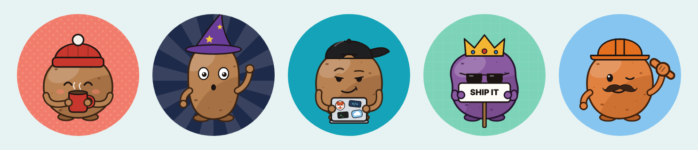

<p align="center"></p>

# potato-me 🥔

**Build a potato. Become the potato.**

A tiny web app for making a potato avatar for GitHub, Slack, Google or anywhere else that wants a square profile picture. Pick a shape, a face, a hat and some gear, then download a 512 × 512 PNG.

- **No build step, no dependencies.** Plain HTML, CSS and JavaScript modules.
- **Private by design.** Everything runs in your browser. Nothing is uploaded.
- **Shareable.** Every potato lives in the URL, so a link is the potato.
- **Crop-aware.** The preview shows the circle most sites crop avatars to.

## What you can change

| Tab | Options |
| --- | --- |
| Body | 4 shapes, 5 skins (russet, red, purple, sweet, ghost) |
| Face | 6 eyes, 5 mouths, blush |
| Hat | Backward cap, beanie, wizard, crown, hard hat, none · 7 colors |
| Gear | Laptop with stickers, coffee, a sign with your own text, or a free hand to wave or throw a shaka · shades, mustache, bow tie |
| Background | 8 colors · solid, dots, rays, grid |

That's tens of thousands of potatoes before you even type on the sign.

## Run it locally

```bash
npm run dev      # serves the folder at http://localhost:5173
npm test         # Node's built-in test runner, no installs
```

Any static server works (`npx serve`, VS Code Live Server, etc.). Opening `index.html` straight from disk won't work because browsers block ES modules on `file://`.

## Deploy

It's a static site. On Vercel: import the repo, leave the framework preset on **Other**, no build command, output directory `.`. Same story on Netlify, GitHub Pages or Cloudflare Pages.

## How it works

```
index.html          page shell
src/options.js      every choice the editor offers, plus the defaults
src/state.js        validate state, encode/decode the URL hash, randomize
src/compose.js      state → SVG string (pure; runs in Node for tests)
src/main.js         the editor UI
src/export.js       SVG → PNG download (browser only)
test/               node:test suites
```

`composeSVG(state)` is a pure function, so the preview, the option thumbnails, the tests and the export all use the same renderer. The art is hand-written SVG paths on a 512 × 512 canvas.

## Adding a new part

1. Add the option to `OPTIONS` in `src/options.js`.
2. Draw it in the matching function in `src/compose.js` (`hat()`, `eyes()`, `mouth()`, …). Use the body's anchors (`b.top`, `b.face`, `b.armY`) so it fits every shape.
3. Run `npm test`. The suite renders every option and every body × hat × item × gesture combination and fails on broken markup.

See [ROADMAP.md](ROADMAP.md) for what's next and [CLAUDE.md](CLAUDE.md) for working on this repo with Claude Code.

## License

[MIT](LICENSE). Make all the potatoes.
