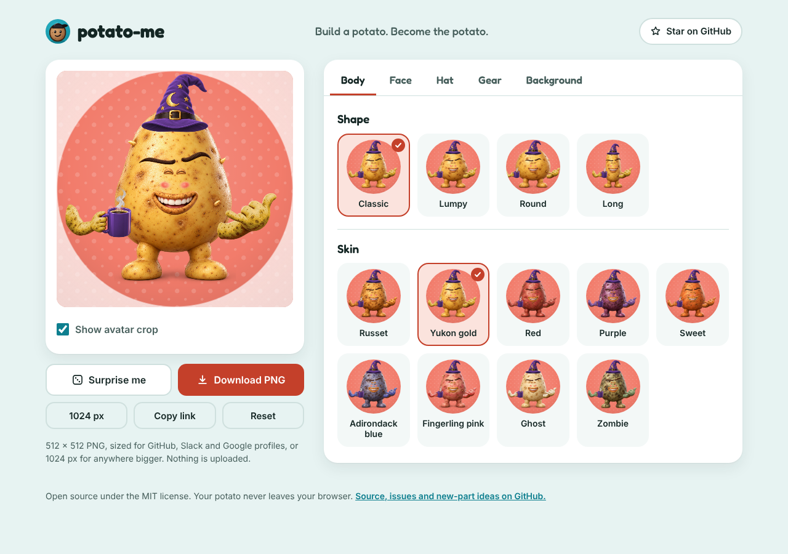

<p align="center"></p>

<h1 align="center">potato-me 🥔</h1>

<p align="center"><strong>Build a potato. Become the potato.</strong></p>

<p align="center">
  <a href="https://github.com/WaylandP/potato-me/actions/workflows/ci.yml"></a>
  <a href="LICENSE"></a>
  
</p>

A web app for making a rendered 3D potato avatar for GitHub, Slack, Google or anywhere else that wants a square profile picture. Pick a shape and skin, a face, a hat and some gear, then download a 512 × 512 PNG (or 1024 for bigger places).

- **Rendered, not drawn.** Every part is a studio-lit 3D render with real potato skin, stacked in your browser on a canvas.
- **No build step, no dependencies.** Plain HTML, CSS and JavaScript modules. Clone it and open it.
- **Private by design.** Everything runs in your browser. Nothing is uploaded, no accounts, no tracking.
- **Shareable.** Every potato lives in the URL, so a link *is* the potato.
- **Crop-aware.** The preview shows the circle most sites crop avatars to, so nothing important gets cut off.

<p align="center"></p>

## What you can change

| Tab | Options |
| --- | --- |
| **Body** | 4 shapes (Classic, Lumpy, Round, Long) × 9 skins (Russet, Yukon gold, Red, Purple, Sweet, Adirondack blue, Fingerling pink, Ghost, Zombie) |
| **Face** | 10 one-click vibes · 14 eyes · 7 eyebrows · 12 mouths · blush or freckles · 5 kinds of facial hair |
| **Hat** | 19 hats, each in 12 colors · initials embroidered on caps, beanies and headbands |
| **Gear** | Hold a laptop, a coffee, a wrench or a book · 26 laptop stickers, pick up to 6 · shaka free hand · 6 kinds of eyewear · 6 kinds of neckwear · headphones, earbuds, band-aid, earring or flower |
| **Background** | 14 colors × 12 patterns, including a studio spotlight |

That's tens of trillions of combinations before you pick stickers or type on the cap. **Surprise me** picks one for you.

A few parts are still being rendered and show up as "not drawn yet" in the editor: ten more free-hand poses, eleven more things to hold (including the sign), raised eyebrows and four stickers. `docs/IMAGE_PROMPTS.md` has the prompt for each one.

## Run it locally

Node 20 or newer is the only requirement.

```bash
git clone https://github.com/WaylandP/potato-me.git
cd potato-me
npm run dev
```

Then open <http://localhost:5173>. `npm run dev` starts a tiny dependency-free static server (`scripts/serve.mjs`); any other static server works too. Opening `index.html` straight from disk won't work because browsers block ES modules on `file://`.

```bash
npm test          # Node's built-in test runner, no installs
npm run assets    # rebuild thumbnails and the asset index after adding part images (needs Playwright)
npm run hero      # rebuild the README banner and link-preview card from the app (needs Playwright)
npm run shot      # screenshot any potato or the whole page for review (needs Playwright)
```

Playwright is an optional dev tool, not a dependency: `npm i -D playwright && npx playwright install chromium`.

## Deploy

It's a static site, so any static host works with no build command and `.` as the output directory.

[](https://vercel.com/new/clone?repository-url=https://github.com/WaylandP/potato-me)

- **Vercel:** import the repo, leave the framework preset on **Other**, no build command, output directory `.`.
- **Netlify / Cloudflare Pages:** same settings: no build command, publish directory `.`.
- **GitHub Pages:** Settings → Pages → deploy from branch `main`, folder `/ (root)`.

## How it works

```
index.html            the editor
fit.html              fitting page: nudge any part on any body shape, copy the result into fit-data.js
assets/parts/         138 rendered parts, 1024 px transparent PNGs placed on a shared canvas
assets/thumbs/        256 px copies for the option grids (generated)
assets/manifest.json  inventory of the parts with placement boxes and checksums
src/assets.js         static index of the parts (generated from the manifest)
src/fit-data.js       per-shape transforms, recolor lists, cap text boxes, laptop lid corners
src/raster.js         the compositor: stacks layers, recolors, tints skin, stamps stickers, letters initials
src/options.js        every choice the editor offers, plus the defaults and presets
src/state.js          validate state, encode/decode the URL hash, randomize, migrate old links
src/main.js           the editor UI
src/parts/            SVG backgrounds and the fallback sticker art
src/compose.js        the older SVG potato renderer, kept for backgrounds and tests
scripts/              dev server, thumbnail builder, screenshot and hero tools
test/                 node:test suites
```

The parts were generated with ChatGPT's image generation from the prompts in `docs/IMAGE_PROMPTS.md`: one base potato, then every part rendered alone at the position it would occupy on that base. The app stacks them in manifest order with small per-shape transforms. Hats, neckwear, headphones and the mug were rendered in one red colorway; a hue mask recolors just those pixels to the chosen color while keeping the shading, so white trim, dark bands and gold stay as they are. Arms were rendered in russet and are tinted to the chosen skin the same way. Stickers are projected onto the blank laptop lid, and cap initials are lettered on with an embroidery effect. Export composes at 1024 px and downsamples to 512 px, which comes out around 430 KB.

## Adding a new part

1. Generate it with the matching line in `docs/IMAGE_PROMPTS.md`, as a 1024 × 1024 transparent PNG positioned on the base potato, and save it as `assets/parts/<group>/<key>.png`. The key must exist in `OPTIONS` (`src/options.js`); add it there first for a brand-new part.
2. Add it to `assets/manifest.json` (copy a neighbouring entry: group, key, path, `placedBox` = the image's opaque bounds) and run `npm run assets` to rebuild the thumbnails and `src/assets.js`.
3. Open `fit.html`, check it on all four body shapes, and paste any nudges into `src/fit-data.js`. Red colorway parts also go in `FIT.recolor`.
4. `npm test`, then `npm run shot` a few combinations and look at them.

[CONTRIBUTING.md](CONTRIBUTING.md) has the full guide. [ROADMAP.md](ROADMAP.md) lists what's next, and [CLAUDE.md](CLAUDE.md) covers working on this repo with Claude Code.

## License

[MIT](LICENSE) for the code. The rendered part images were generated for this project and are included under the same license. Make all the potatoes.
