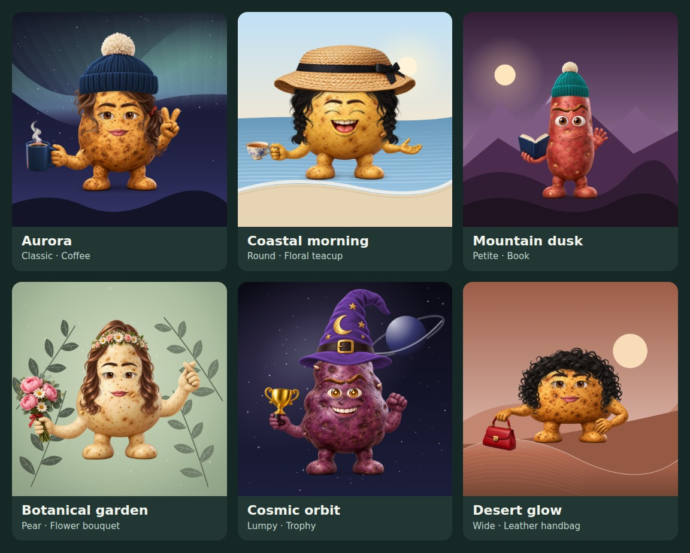

# potato-me 🥔

**[Build your potato →](https://potato-me.vercel.app/)**

Make a potato that looks like you, or a tiny wizard who takes their reading seriously. Choose a shape, dress it up, and give it something to do with its hands. Download a profile picture or send someone a link they can open and edit.

[](https://potato-me.vercel.app/)

## Pick a starting point

The **A little inspiration** shelf shows six of the editor’s 18 ready-made looks. Pick one to customize, or use **Shuffle ideas** for six more. Two you can open right now: [Moon mood](https://potato-me.vercel.app/#character=female&body=round&skin=ghost&eyes=side&brows=softArch&mouth=smile&hair=bun&hairColor=silver&hat=halo&item=book&gesture=rest&jewelry=starStuds&bg=periwinkle&pattern=stars&stickers=) and [Tiny wizard](https://potato-me.vercel.app/#body=long&skin=blue&eyes=stars&brows=raised&mouth=oh&hat=wizard&hatColor=purple&item=book&gesture=point&bg=plum&pattern=orbit&stickers=).

- **Shape and expression:** six body shapes, nine skins, hairstyles, faces and facial hair. Every part is available from either starter.
- **Outfit and pose:** fit a hat over the hair, add glasses or jewelry, choose a prop for one hand and a gesture for the other. Add initials to supported hats, a message to the sign, or stickers to the laptop.
- **Picture and link:** choose a background and check the circular avatar guide. **Download PNG** saves a square 512 × 512 or 1024 × 1024 image. **Copy link** saves the editable choices, including custom text, in the URL.

### From the editor



[Open the coastal sunhat and braids example](https://potato-me.vercel.app/#body=round&skin=gold&hat=sunhat&hair=braids&hairColor=black&eyes=joyLashes&mouth=laugh&brows=softArch&item=teacup&gesture=palmUp&bg=sky&pattern=coast).

## Run locally

Use **Node.js 20+**. The app and its tests need no dependency installation or build step.

```sh
git clone https://github.com/WaylandP/potato-me.git
cd potato-me
npm run dev
```

Open [localhost:5173](http://localhost:5173/). Run `npm test` to check the project. For static hosting, serve the repository root. The editor layers transparent artwork on a Canvas; rendering and export happen in the browser. There are no accounts, uploads, public posts or bundled analytics.

## Project links

[Contribute](CONTRIBUTING.md) · [Report a bug](https://github.com/WaylandP/potato-me/issues/new/choose) · [Roadmap](ROADMAP.md) · [Changelog](CHANGELOG.md) · [Releases](https://github.com/WaylandP/potato-me/releases) · [Artwork and visual reviews](docs/README.md)

Code and project artwork: [MIT license](LICENSE). The artwork was created with ChatGPT image generation. The bundled Fredoka font uses the [SIL Open Font License](assets/fonts/OFL.txt).
