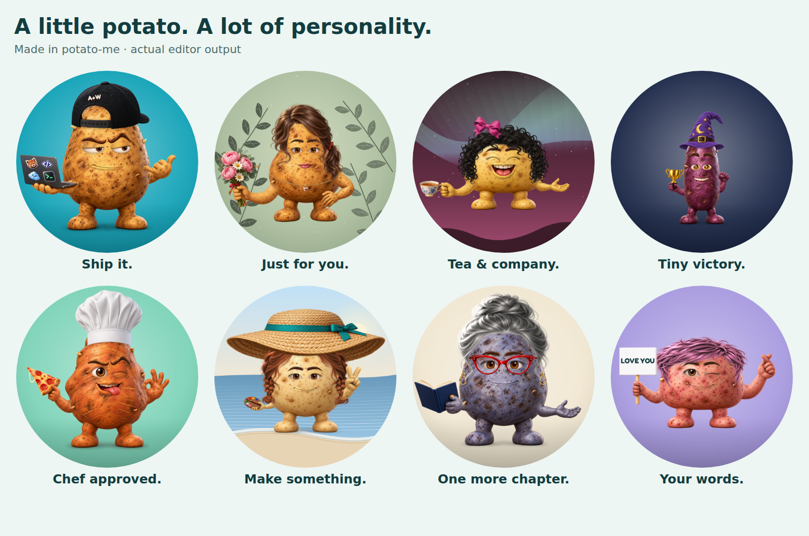

# Rendered asset completion — November 1, 2026

The final 26 missing assets are generated and integrated with the renderer. The
inventory now contains all 164 planned assets. The previous 138 full-resolution
PNGs are unchanged. The completed pack is live at
[potato-me.vercel.app](https://potato-me.vercel.app/) and was verified in
production on November 1, 2026.

## Added artwork

- Raised eyebrows, kept separate from the eyes.
- Ten gestures: rest, wave, thumbs up, peace, point, rock on, OK, fist, salute,
  and flex. The existing shaka is reused.
- Eleven held-item layers: boba, phone, controller, sign, pizza, donut, duck,
  microphone, trophy, plant, and the empty resting hand.
- Four laptop stickers: 404 (`notFound`), skull, mountains (`mountain`), and LGTM.

All new assets are 1024 × 1024 transparent PNGs. Each was generated separately
with the built-in image-generation tool using existing PNGs as visual references.
The exact prompts are in [ASSET_COMPLETION_PROMPTS.json](ASSET_COMPLETION_PROMPTS.json). Normalization resizes
the canvas and clears imperceptible alpha values of 1/255 or less; artwork is
fitted through uniform transforms in `src/fit-data.js` without distortion.

`npm run assets` rebuilt the index and 256 × 256 thumbnails. Existing thumbnail
files were retained to avoid unrelated browser-encoder differences.

## Integration

- Per-part fitting on all four body shapes, including a narrower raised-brow
  fit on Long and smaller arm/prop fits on Round.
- Protected prop regions preserve food, gold, wood and terracotta during skin
  tinting. Hands remain tintable.
- The blank sign now renders editable text in the raster compositor. Text
  follows the sign transform, fits its board, and is included in PNG exports.
- Option keys and URL state remain compatible. `composeSVG` is unchanged.
- Missing-part fallback remains covered by a temporary-unavailability test.

## Verification

- `npm test`: 32 passing tests.
- All 26 new PNGs decode as 1024 × 1024 RGBA with transparency; all 26 new
  thumbnails decode at 256 × 256.
- 312 rendered combinations: 26 new options × four shapes × three skins
  (russet, gold, purple). Each also passed URL-state round-trip and PNG export.
- Largest measured 512 × 512 export: 441,284 bytes, below 1 MB.
- New arm/prop/brow layers checked against square and circular crops on all
  four shapes. A one-pixel microphone circle overrun on Round was adjusted and
  the targeted recheck found zero pixels outside the circle.
- Visual review of all new gestures and held items; assembled shape/skin sheets.
- Desktop (1280 px) and phone (390 px), light and dark: controls, keyboard
  selection, sign editing, thumbnails, download and horizontal overflow checked.
- No application errors or failed local resource requests during UI checks.
- Pixel samples on protected props remain identical between russet and purple;
  sign-text changes produce different exported artwork.

These checks cover the new asset pack and representative combinations. They are
not a claim to have visually reviewed every possible avatar combination.

## Production verification — November 1, 2026

PR [#1](https://github.com/WaylandP/potato-me/pull/1) merged as
`8ad8773dbe94754c4ad23f74f0edcba3f38f6e74`. Vercel automatically deployed that
commit to production, reached `READY`, and assigned
[potato-me.vercel.app](https://potato-me.vercel.app/).

- The public URL returned HTTP 200 without authentication.
- SHA-256 checks matched 60 served files to the merged source: all 26 new parts,
  their 26 thumbnails, and eight application/manifest files. No planned parts
  were missing from the live inventory.
- Four browser checks covered desktop (1280 px) and phone (390 px), each in
  light and dark mode, with one of the four body shapes in each check.
- Sign editing, mouse/keyboard gesture selection, thumbnails, share-link reload,
  and the actual Download PNG button passed. No horizontal overflow, browser
  errors, or failed resource requests were observed.
- Downloaded PNGs were 512 × 512; the largest of these four exports was
  434,303 bytes.
- Vercel reported no runtime errors in the one-hour window checked. This static
  app renders in the browser; the browser checks provide the client-side evidence.

## Repository status

This completion work builds on `WaylandP/potato-me` main commit
`237f1977929f7543f519c793fdd6805fe9ca11a3`.

The repository contains the complete 164-part inventory, generated thumbnails,
fitting data and compositor changes. No separate asset pack is needed to run
this checkout. Follow the [README](../README.md) for setup and the
[contributor guide](../CONTRIBUTING.md) when changing artwork.

The completion-pack, sign-text and deployment roadmap items are checked after
local and production verification. Remaining roadmap items retain their own
completion criteria.
