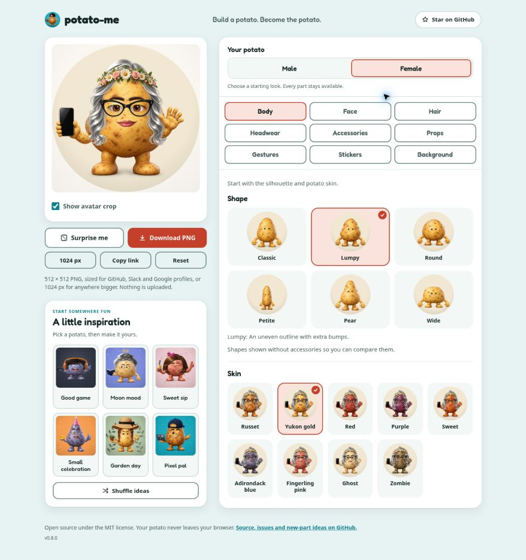

# Attachment, body identity and editor review — v0.8.0

The subsequent [v0.8.1 hand and grip review](GRIP_REVIEW.md) revisits anatomy and object support across every hand. It replaces the ambiguous book/donut grips and corrects mug/sign/trophy material boundaries. The v0.8.0 results below remain historical; mask, attachment and crop checks did not establish convincing grip anatomy.

This follow-up starts from the user's reported Lumpy/gold/silver-waves look, flower-crown overlap, incomplete-looking section buttons and unused space beneath the preview. It records visible defects separately from automated rendering checks. Version 0.8.0 was published and verified on production on November 3, 2026.

## Findings and corrections

| Finding | Correction and scope |
| --- | --- |
| A fully dressed body thumbnail hid Lumpy's outline behind hair and props | Use the same neutral face, resting hands, selected skin and plain background for all six shape choices. The editor's outfit remains selected when the body changes. Arrange the choices in a consistent 3-by-2 grid. |
| Zombie Lumpy's source silhouette was nearly identical to Classic Zombie | Replace this one source image using the established Lumpy russet outline and original zombie material as references. Regenerate its thumbnail and the asset index. A PNG-alpha contour test now distinguishes Lumpy from Classic in all nine skins. |
| Original orange skin remained on several gripping fingertips, thumb edges and palms | Retrace the masks for laptop, phone, controller, donut, duck, plant, palette, book, bouquet, teacup and pizza. Protect actual object material, excluding the skin that crosses in front of it. |
| Some masks recolored the duck breast or bouquet ribbon as potato skin | Preserve the object around each supporting finger; keep yellow rubber, ribbon, stems, clay, wood, paint, food, metal and ceramic details intact. |
| Coarse mask sampling left visible rims in native exports | Sample item skin masks at 512 px and test polygons at source-pixel centers. Keep shoulder search bands, averaging distances and pigment-gap fill distances in world units. Gestures retain their existing sampling. |
| Changing a hair or hat color could subtly move or resize the character | Associate each recolored canvas with its original source image and use that image for framing silhouettes. This keeps the original camera and fitting formula while removing Image-versus-Canvas downsampling differences. The mapping uses weak references and does not retain evicted processed images. |
| Section buttons appeared open at the bottom | Remove the transparent bottom border. Use a complete 2 px outline, stronger control-boundary contrast, distinct selected fill and consistent hover/focus behavior in both themes. |
| The area below the preview had no useful content | Add 18 complete inspiration looks, six at a time, with shuffle and one-click editing. The shelf uses small source thumbnails, waits for the first preview, and loads near the viewport. On phones it follows the editor controls. |
| An already-open editor could continue running an older release without showing its version | Display v0.8.0 and check the public version file when returning to the tab. Offer an optional refresh that preserves the exact encoded potato. An open pre-v0.8 tab needs one manual refresh to receive this feature. |

The gold Lumpy source already has an uneven outline; its dressed thumbnail obscured it. The Zombie source had a separate, real artwork defect. The old Zombie Lumpy/Classic mean contour difference was 3.4 source pixels; the replacement is 17.72 pixels. This is measured over both opaque outline edges on source rows 200–750, independently of the renderer's fit tables. The regression threshold is 7 pixels for every skin. [attachment-image-prompts.json](attachment-image-prompts.json) records the replacement prompt, references, normalization and checksums.

## The reported flower crown

The reported visible choices were reconstructed as Lumpy, gold skin, silver waves, flower crown, cat-eye glasses, phone and wave. Unshared facial details use the Female starter, and the audit records the complete actual state. The fresh v0.7.1 production render and local baseline did not show the detached rear twig tips in the supplied screenshot. The exact cause of that screenshot discrepancy cannot be established from the image alone.

The new review includes the reconstructed look without the crown, hair or glasses; a chestnut control; blue and purple contrast controls; and all six shapes. Rear twig witnesses are checked independently against the source PNG, and native images are visually inspected for intact front flowers/leaves and natural placement. This release does not claim a new flower-crown geometry correction where the current source already rendered correctly.

## Verification record

The [machine-readable evidence](attachment-evidence.json) retains exact case coverage, source fingerprints, findings, inspected image lists and the separate final follow-ups. The broad matrix completed all **10,612 planned cases**, with no missing, duplicate or unexpected case IDs across 22 disjoint runs:

| Matrix | Cases | What it covers |
| --- | ---: | --- |
| Inventory | 5,022 | Every included headgear, hairstyle, facial-hair, accessory, held-item and gesture option on all six shapes and nine skins |
| Materials | 2,124 | Supported hair, hat, neckwear, extra, eyewear and coffee palettes |
| Interactions | 3,466 | Headgear with hair, accessories with hair, headphones with every hat, beard/scarf combinations, and 268 arm combinations covering all 815 required arm pairs |

The broad run used source fingerprint `d66895900e754f4a20a6da95fb34048ac3cffbb956f7c418c827e4884ed9ea90`. All source/asset completion comparisons matched their starting fingerprints. Inventory and interaction runs had no automated geometry, crop or share-state findings. The strict material-alpha comparison raised **129 findings**, retained in the evidence rather than counted as clean passes.

All broad contact sheets were actually inspected, divided into four review records: headgear (100 sheets / 3,468 cells), accessories (91 / 2,976), stacked headphones and facial hair (51 / 1,416), and hair/arms/held items (57 / 2,752). These total 299 primary sheets and 10,612 cells. Supplemental whole-frame images are recorded separately and are not counted twice. Contact-sheet inspection found no remaining static attachment defect, but the material-alpha findings exposed a real camera defect that required a final correction.

### Color-dependent framing: found and corrected

Chromium did not produce identical low-resolution alpha samples when the same source pixels arrived as an original PNG Image versus a recolored Canvas. A faint bun wisp crossed the framing threshold in one path; on Classic this moved the camera center by about five world pixels and changed scale by about 0.7%. Native follow-up also found 2–8 px boundary movement in 16 hat color pairs. The correction measures framing from the original image for both paths. Drawing and wearer geometry still use the selected material normally.

The final source fingerprint is **`230af7cc49ea1702503c904f28b130e41dd1b2673e40fcddd095b1a0ca5f8409`**. The complete broad matrix was not rerun after this isolated framing correction. Instead, the final source passed the following targeted checks:

- **84 Chromium bun renders:** all six shapes and all six colors using full and actual thumbnail sources, plus 12 native 1024 px proofs. All rendered alpha comparisons were identical (maximum delta 0). Twelve independent original/copy/tinted diagnostics confirmed identical camera and wearer geometry. Both palette sheets and all 12 native images were visually inspected.
- **104 non-hair flagged pairs:** every remaining original material finding was rerendered as a native 1024 px reference/color pair (208 renders). Maximum opaque-boundary and bounding-box differences were one native pixel; the larger camera drift was gone. Edge alpha values can still differ because of browser resampling; these are not claimed to be pixel-identical.
- **12 native reported-look controls:** the reconstructed flower-crown look, missing-layer controls, chestnut/blue/purple controls and other five shapes were rerendered and individually inspected. No automated or visible attachment finding remained in those images.
- **756 complete-character shape renders / 342 comparisons:** the final source retained Petite's proportion limits. Maximum Petite/Classic width ratio was 0.5603 and height ratio 0.8305, with no audit errors.
- **Node test suite:** all 13 test files passed on Node 24.22.1 after the final source correction. CI uses Node 22 and is checked separately for the published commit.

The earlier native grip review additionally inspected 34 full-size cases: every held-item layer in blue, every gesture in purple and the new Zombie Lumpy with resting arms. That review preceded only the framing correction. All review scopes and their source identities are kept separate in the evidence.

Completed body-art gate: all 54 body/skin combinations passed the existing inventory's 512 px export, 96 px thumbnail, share round-trip and circular-crop checks. All 54 cells of its body sheet were visually inspected. The largest tested body export was 356,732 bytes.

Completed editor review: 20 browser check groups passed, including all nine sections, inspiration selection/shuffle, share/reload pixels, version-refresh state preservation, keyboard interaction, retry recovery, downloads, and 390 px light/dark layouts. There were no page errors or third-party requests. The tested 512 px download was 272,491 bytes and the 1024 px download was 988,923 bytes. Tablet widths 821, 900 and 901 px were also checked. This UI run preceded the final item-mask refinements; final artwork and production checks are recorded separately.

The hero, social preview, completion gallery, favicon and editor screenshot were regenerated from the final source and visually inspected. Four additional layout/state-preservation checks passed with zero page errors; final 390 px controls and inspiration crops were inspected in both themes. The final shape review additionally inspected 108 whole-frame states across all six shapes, nine skins and both presets; this is a visual sample of the 756 renders, not a claim that every shape-audit image was viewed.

## Published verification — November 3, 2026

[PR #13](https://github.com/WaylandP/potato-me/pull/13) published application commit **`81fa9f2929109f34e88d760c03683a57a062689a`**. The uploaded Git tree matched the reviewed local tree exactly. Both PR CI and the [main push CI run](https://github.com/WaylandP/potato-me/actions/runs/41558403012) passed. Vercel deployment **`dpl_8jrF1Xc6ZRepqXiseKRXFDpPpmU7`** reported `READY`, target `production`, that exact Git commit, and the `potato-me.vercel.app` alias.

Validated HTTPS reads returned HTTP 200 for 17 release files and matched the reviewed local bytes and SHA-256 hashes. These include the page, editor/style/rendering modules, manifest, both Zombie Lumpy PNGs and all regenerated public preview images. Certificate and hostname validation remained enabled.

The live Chromium editor showed v0.8.0 and the neutral gold/Zombie shape choices. A live shuffle replaced all six inspiration cards; loading Moon mood applied its complete state, and choosing Lumpy preserved the rest of the outfit. Copy link returned the exact encoded URL after its completion toast, and reloading retained the shared state. An initial clipboard read was made before the async copy completed; the successful follow-up is recorded rather than treating that early empty read as an application defect.

The reconstructed flower-crown look was downloaded through both actual production buttons. The resulting valid RGBA PNGs measured **512 × 512 / 370,040 bytes** and **1024 × 1024 / 1,623,822 bytes**. The full-size download was visually inspected: front flowers remained intact, rear branches were tucked, and the phone grip and waving arm were connected. No application console errors were observed during the recorded live checks; browser-extension metadata errors are identified separately.

The evidence index includes deployment identity, CI, production file hashes, actual download hashes and the live-browser record. These checks identify the application commit above; this documentation was completed afterward without changing its application files.



## Reproduce the matrices

```bash
npm test
npm run audit:attachments -- /tmp/attachments-reported reported
npm run audit:attachments -- /tmp/attachments-inventory inventory
npm run audit:attachments -- /tmp/attachments-materials materials
npm run audit:attachments -- /tmp/attachments-interactions interactions
npm run audit:color-framing -- /tmp/color-framing
npm run audit -- /tmp/body-exports inventory body
npm run audit:shapes -- /tmp/shape-review
npm run audit:ui -- /tmp/editor-review
```

The broad inventory and material modes use full PNG sources and 256 px output. Interactions use the actual 256 px thumbnail sources. `AUDIT_SOURCE=full` changes that explicitly; `AUDIT_SIZE=1024` produces native proofs. `AUDIT_GROUPS`, `AUDIT_MATCH` and `AUDIT_LIMIT` are recorded filters, and `--plan` writes the complete expected case list. Separate groups can use different `AUDIT_PORT` values; coverage must be aggregated by exact case ID, checking for omissions and duplicates. Reports fingerprint the source files and used PNGs, then check them again at completion.

## Limits

Contact sheets establish the recorded visual review at their stated size; they are not substitutes for native contact inspection. The measured matrices cover each listed part and selected interactions, not every complete outfit. Source artwork still has baked texture and lighting. Chromium desktop and responsive phone layouts are covered; physical iOS/Safari, Android hardware and manual screen-reader reviews remain separate work.

Inspiration looks are bundled, editable examples. This release does not add user accounts, an upload service or community posting. Share links continue to hold the avatar state in the URL fragment.
