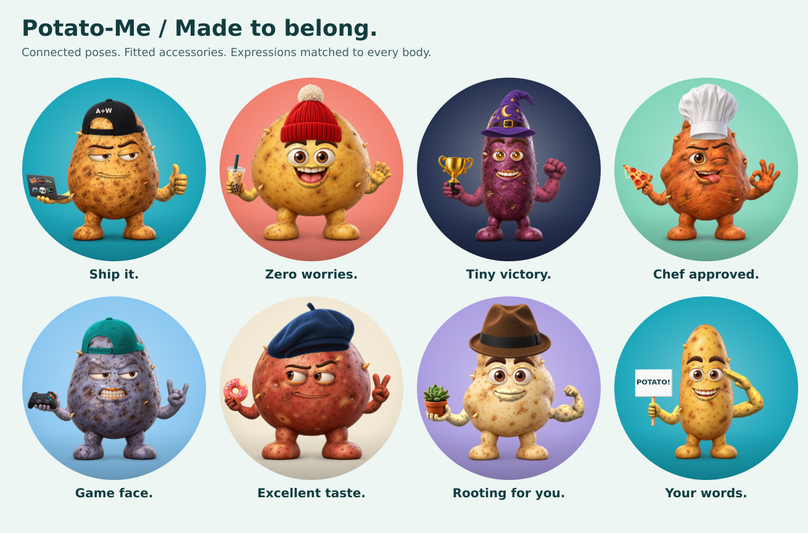

# Character fitting repair — November 2026

The completed inventory still looked assembled from unrelated stickers: rounded arm ends sat on top of bodies, faces kept tan rims on other skins, and several accessories floated or were out of proportion. Asset counts and successful exports did not catch these visual defects.

## Rendering changes

`src/surface.js` reads the selected body image to find its silhouette, crown, face width, shoulder edges and material color. It fits every rendered category against those measurements. Facial feature sizes are bounded so Round does not acquire oversized eyes and Long does not lose its expression.

Arm roots are tucked inside the body and locally occluded by its alpha silhouette. The hand and prop remain one image, preserving the grip. A crop check reduces an oversized pose around its shoulder. The older coffee and book art faces inward; explicit shoulder anchors mirror those complete layers into the correct holding direction.

Skin masks distinguish exposed potato skin from enclosed eye and mouth interiors. The renderer preserves source shading, samples the selected body's material, softens exposed skin edges and adds small contact shadows under worn parts. Closed eyelids, sculpted eyebrows and chin stubble also follow the body. Protected prop polygons preserve food, gold, ceramic, paper and clay colors.

Hats sit against the crown; eyewear follows the eyes; earbuds, the earring and flower follow the body edge. Neckwear has height limits. The beard's actual mouth opening is aligned with the selected mouth. Headphone cups stay rigid while the upper band flexes to the crown or a compatible hat.

The headband and headphones were regenerated as separate transparent images with the existing art as reference. Both 1280 px outputs were normalized to 1024 px without cropping, registered with new bounds and SHA-256 checksums in `assets/manifest.json`, and given regenerated thumbnails. The other 162 source PNGs remain unchanged; their assembled appearance changes through the compositor.

Manual fitting remains available: `fit.html` edits `FIT.surfaceNudges`, applied after automatic placement. Existing option keys, share links, editable sign/cap text and laptop sticker projection remain supported. The legacy pure SVG compositor is unchanged.

## Review and verification

The reproducible browser audit is `node scripts/audit-art.mjs /tmp/potato-art-audit`. It renders every source asset, saves circular review sheets, exercises 512 px exports and 96 px thumbnail renders, and checks share-state round trips. Its full inventory matrix is 548 cases: all 36 body/skin combinations, plus every other asset on all four body shapes. Visual inspection is a separate step; passing the script alone is not a visual-quality approval.

Local verification on November 1, 2026 ([machine-readable report](character-fit-verification.json)):

- 37 Node tests passed.
- 548 inventory cases passed render, PNG-size, thumbnail and share-state checks. Visual review prompted fixes to eyelid/lip masks and eyewear sizing; 140 face/body cases and 24 eyewear cases passed targeted reruns afterward.
- The largest 512 px PNG in these inventory runs was 395,414 bytes. Four complete UI flows produced a largest download of 427,823 bytes; all were below 1 MB.
- Desktop (1280 px) and phone (390 px), light and dark: sign editing, mouse/keyboard gesture selection, completed thumbnails, share-link reload, downloads and no horizontal overflow passed. The fitting page produced the new correction format. No application errors occurred. Google Fonts was unavailable in the managed test environment, so those screenshots use the fallback font.
- Review sheets covered every category and all 36 body/skin images, plus 24 headphone/hat combinations. The README, hero and social preview use actual compositor output.

The Node suite includes landmark alignment, beard-opening alignment, manual fitting and headphone-band regression checks, alongside the existing inventory and state checks.

This is a modular 2D compositor using rendered artwork, not a 3D rig. Arbitrary combinations of multiple large accessories can still overlap. Review coverage is every individual asset and representative combined outfits, not the combinatorial product of every setting.
