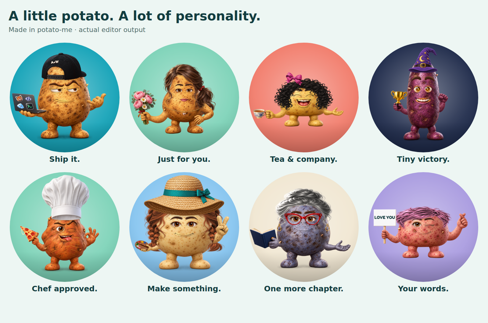

# Everyday-expression audit — v0.5.0

> **Historical record, superseded by [the v0.6 review](COHESION_REVIEW.md).** Subsequent user testing exposed mismatched arm colors, inconsistent hand sizes and an unsuitable hip pose. The visual conclusions below were too strong; the test counts establish only the listed executions, not correctness or aesthetic quality.

Reviewed November 2, 2026. This record covers the expanded 222-image catalog and the browser editor. It supersedes the v0.4 visual coverage in [PUBLIC_AUDIT.md](PUBLIC_AUDIT.md). The [machine-readable evidence](everyday-audit-verification.json) records suite totals, source hashes and the filenames/checksums of the 526 final review sheets.

## What changed

The earlier catalog offered few feminine styles and emphasized developer interests. This update adds 58 source images: Pear and Petite in nine skins each; six hairstyles; three lash expressions and soft brows; three hats; cat-eye glasses; three earring pairs; two necklaces; two clips; four held objects; three gestures; and twelve stickers. A replacement smile is not counted as an addition. All styles remain available on all six body shapes, without gender restrictions.

The new props include a bouquet, handbag, floral teacup and artist palette. Stickers add books, music, photography, pets, flowers and crafts. Labels explain that **LGTM means “Looks good to me”**. Vibe presets change expressions without replacing the selected hair or outfit. Original share keys and the original developer default remain supported.



## Fitting findings and repairs

| Finding | Repair and recheck |
| --- | --- |
| Hair could cover the face or sit above the body | Fit the face opening and crown separately, bound width, retain individual strand detail, and rerun hair/body/skin and interaction matrices. |
| A straight crop through hair produced an artificial edge under hats | Draw the complete hairstyle and let the hat's transparency determine which strands it covers. Frame the combined hair and hat silhouette. |
| Hats could descend into the eyes on Petite or sit too narrowly over hair | Clamp the brim above the eyes, account for the body crown and minimum hair width, and rerun all headwear, hair/hat and color cases. |
| Earrings and skin-mounted accessories could appear in front of long hair | Place earrings, earbuds and skin-mounted extras beneath hair. Keep clips visible on its surface. |
| The hand-on-hip pose needed a different shoulder and wrist relationship | Adjust its shoulder anchor, scale and angle; add contact shading where it rests against the torso. Check every held object/gesture combination on every shape. |
| New prop materials could be tinted with the hand | Protect flowers, leather, ceramic, paint and metal using source-coordinate masks while harmonizing exposed potato skin. |
| Neckwear and small extras were hidden or cropped in option previews | Suppress covering hair/beards in neckwear thumbnails and reposition accessory thumbnail crops; verify the actual editor at desktop and mobile widths. |
| Two imported PNGs were truncated even though a browser could display them | Re-import the waves and strawberry sources. Add strict PNG chunk, decompression, end-marker and manifest checksum checks. All 222 sources and 222 thumbnails pass. |

Neckwear follows the existing torso-wrap design: these characters have no separate human neck. The scarf wraps the upper torso, its sides turn behind the silhouette, and the ends hang below the band. The new pearl necklace and pendant use the same body-relative fitting approach.

## Exact visual coverage

Every final sheet below was opened and visually inspected. The matrices render with the real Canvas compositor, not the legacy SVG renderer. Review covered silhouette contact, hand grips, skin/material boundaries, face readability, accessory layering, shadows and the circular avatar crop. Source artwork and the regenerated README/gallery/editor images were also inspected.

Counts include “none” options where those exist. Interaction suites rotate skins unless explicitly stated otherwise. These **23,922 case executions overlap between suites**; they are not 23,922 unique avatars and do not enumerate every possible full outfit.

| Suite | Coverage | Cases | Final sheets |
| --- | --- | ---: | ---: |
| Inventory | 54 bodies plus each of 168 non-body assets on all 6 shapes × 9 skins | 9,126 | 169 |
| Hair | Each of 6 hairstyles with all hats, extras, jewelry/neckwear pairs and hair colors on every shape | 2,628 | 54 |
| Headwear | 23 hat choices × 8 extras × 6 shapes | 1,104 | 23 |
| Material colors | 26 recolorable parts × 12 accent colors × 6 shapes | 1,872 | 52 |
| Expressions | 12 mouths × 17 eyes × 9 brow choices; shapes/skins rotated | 1,836 | 36 |
| Facial hair | 6 facial-hair choices × 9 neckwear choices × 12 mouths × 6 shapes | 3,888 | 108 |
| Hand poses | 19 holding choices × 14 gestures × 6 shapes | 1,596 | 38 |
| Eyewear | 8 eyewear choices × 17 eyes × 6 shapes | 816 | 16 |
| Pairwise outfits | All 18,324 distinct value pairs across 19 option factors, independently checked | 464 | 9 |
| Details | 138 salute/hat cases, 48 text cases, 42 sticker layouts, 84 presets and 112 seeded random outfits | 424 | 9 |
| Backgrounds | All 12 patterns × 14 background colors | 168 | 12 |
| **Total** | **Overlapping suite executions** | **23,922** | **526** |

The 28 inventory hair/hat sheets were replaced by a final 1,512-case rerun after head-fitting corrections. They are counted once above. Earlier exploratory runs and superseded sheets are excluded from the final visual-review log.

All final suites report zero rendering errors and zero circle findings at the script's threshold: more than eight pixels with alpha above 180 outside radius 127 on the 256 px foreground render. This threshold is a clipping detector, not a judgment of aesthetics. Inventory cases also exercise PNG export, thumbnail rendering and share-state round trips. The maximum 512 px inventory PNG was **460,976 bytes**.

## Editor and integrity checks

The final local run passed **48 Node tests** and **13 browser check groups**, with zero browser errors. The browser checks cover:

- All five tabs and rendered option thumbnails; keyboard tab navigation, selected states, focus and the skip link.
- Text normalization, copying a share URL and reloading it to reproduce the same canvas pixels.
- Valid 512 px and 1024 px downloads, crop guide, reset and Surprise me.
- The six-sticker limit, all new control categories, and representative new sticker selections.
- Concurrent body/skin thumbnail renders matching fresh sequential renders in both mobile themes, with a two-channel-value rounding tolerance.
- 390 px light/dark layouts without horizontal overflow and visible buttons at least 44 × 44 px.
- A deliberately failed body-image request followed by successful retry.
- Fitting-tool controls, invalid numeric input and mobile layout.
- No third-party requests from the editor or fitting tool.

The selected UI test avatar exported at **414,818 bytes (512 px)** and **1,814,535 bytes (1024 px)**. These are measurements of that avatar, not a size promise for every possible composition. All 222 source images are complete 1024 × 1024 PNGs and all 222 generated thumbnails are 256 × 256. No catalog choices are missing their required image.

## Reproduce the checks

Use Node 20+ and the optional Playwright/Chromium setup in [CONTRIBUTING.md](../CONTRIBUTING.md). The app itself needs no install or build.

```bash
npm test
npm run audit -- /tmp/potato-inventory inventory
npm run audit -- /tmp/potato-hair hair
npm run audit -- /tmp/potato-headwear headwear
npm run audit -- /tmp/potato-colors colors
npm run audit -- /tmp/potato-expressions expressions
npm run audit -- /tmp/potato-facial-hair facial-hair
npm run audit -- /tmp/potato-poses poses
npm run audit -- /tmp/potato-eyewear eyewear
npm run audit -- /tmp/potato-pairwise pairwise
npm run audit -- /tmp/potato-details details
npm run audit -- /tmp/potato-backgrounds backgrounds
npm run audit:ui -- /tmp/potato-ui
```

Each visual mode writes contact sheets and a JSON report. Reports deliberately say visual review is pending: a successful script cannot approve its own artwork. Open every generated sheet and record that review separately. The checked-in evidence records that separate inspection for this release. Sheets are reproducible output and are not all committed as large binary files.

## Research and practical limits

[NIST's combinatorial-testing guidance](https://csrc.nist.gov/projects/automated-combinatorial-testing-for-software/faqs) informed the pairwise suite. Our deterministic generator is accompanied by an independent pair-coverage verifier. Pair coverage does **not** establish coverage of all three-way or higher interactions, arbitrary custom text, or every ordered sticker subset. The targeted matrices above supplement it where placement interactions are especially likely.

[Microsoft Inclusive Design](https://inclusive.microsoft.design/) informed the decision to broaden styles and interests without locking accessories to a gender or body. This is a design choice, not a claim that a particular hairstyle, hobby or shape defines a gender.

The project remains a modular 2D image compositor. It cannot simulate 3D cloth, anatomy or lighting for every possible combination. Long hair intentionally covers some earrings and necklace sections; beards can cover the centers of collars or bow ties; wide brims can obscure parts of eyebrows. Choose a shorter hairstyle or remove an overlapping accessory when you want it fully visible. These intentional occlusions are separate from detached parts, broken grips or exposed rectangular edges.

Verification used Chromium on Linux, including mobile viewport emulation. Physical Safari/iOS and Android device checks, manual VoiceOver/NVDA review and a recorded Lighthouse audit remain open in [ROADMAP.md](../ROADMAP.md). No claim of pixel-perfect output or exhaustive full-outfit coverage is made.

## Deployment

The [public editor](https://potato-me.vercel.app/) was verified on November 2, 2026 at runtime commit `504f8ded07f3e3c40a96e968d255b037066327ba`, Vercel deployment `dpl_68mdZUJwYq7ZNDZiYvdoMsgQUgPc`. All **495 checked public assets and source files** returned HTTP 200 with SHA-256 hashes matching the reviewed repository. This includes the complete source/thumbnail catalog, fonts, renderer/editor code, HTML, favicon and four documentation images. Vercel returned 404 for `package.json`; it is repository metadata and is not needed by the browser.

All **13 browser check groups also passed against the public URL**, with no browser errors or missing catalog parts. This includes actual share/reload, PNG downloads, mobile layouts, failure/retry and fitting-tool interactions. The [production evidence](everyday-production-verification.json) contains individual file hashes and the browser checks. The follow-up commit records these results without changing runtime files.
