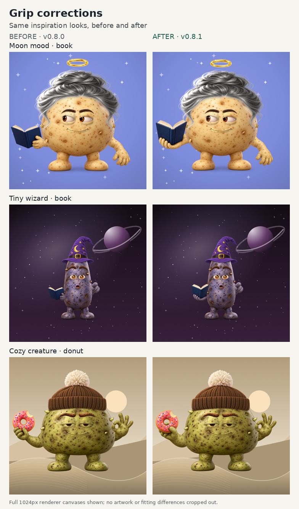

# Hand and grip review — v0.8.1

**Published and verified on November 3, 2026 (America/New_York).** [PR #15](https://github.com/WaylandP/potato-me/pull/15) shipped the reviewed application to [potato-me.vercel.app](https://potato-me.vercel.app/). The [production record](grip-production.json) identifies the exact commit and deployment.

Artwork hashes and generated filenames in this report identify the [exact v0.8.1 source tree](https://github.com/WaylandP/potato-me/tree/03a220abe33a12552ff05bf6a2f9abae09f073d4), including documentation images later retired from the working tree.

A fresh visual anatomy review covered **33 layers: 18 held objects, the empty item hand and all 14 free-hand gestures**. It selected two source-art revisions, book and donut, because their old grips made hand/object depth difficult to read. The other **31 source-art layers are retained**. The accepted book2 and donut1 source candidates have been normalized into the asset pack; fitting and material-mask integration are complete, and the final local rendering, visual and regression checks have passed.

The old book and donut grips show **ambiguous same-face contact**. The review does not establish conclusively impossible anatomy or missing fingers. A digit can be naturally hidden by an object, and a back-of-hand view can place the thumb differently from a palm-forward view. Those distinctions matter when reviewing a stylized hand.

All **18 inspiration looks/themes** retain their existing definitions in [src/inspiration.js](../src/inspiration.js). Its SHA-256 remains `b7b2db488145ec2d78d11af509f2300cb39583d425b3ea61800e28ac61c18975`, matching baseline commit `726073b047a73bf730814bc532910d9025992814`. This revision changes the book and donut artwork used by those looks; it does not redesign the themes.

## What was actually inspected

Three independent review groups examined original source art and existing native output for thumb opposition, finger paths and occlusion, palm/back-of-hand consistency, wrist continuity, object support and the correct arm attachment. [grip-evidence.json](grip-evidence.json) embeds all 33 per-layer findings, original-source and native-proof SHA-256 hashes, review-ledger hashes, accepted-candidate findings and normalization records.

| Review group | Layers | Inspected evidence |
| --- | ---: | --- |
| Priority six | 6 | Source PNG grip crops, including enlarged views, and native-scale crops from six existing 1024 px Classic/blue proofs. |
| Other held props | 8 | Eight source PNGs and eight individual existing 1024 px Classic/blue proofs, with supporting contact sheets. |
| Four props, empty hand and gestures | 19 | All 19 source PNGs individually; four props and the empty hand at 1024 px; all 14 gestures in 1:1 native attachment crops, with the resting gesture also viewed individually. |

These existing native images were captured at `2026-11-03T00:45:54.241Z`, **before the canonical recolor-framing correction and before the new book/donut artwork**. They are useful evidence for the old source grip relationships and the fresh anatomy review. They are not final v0.8.1 renders. Their capture source hashes and exact inspected proof filenames are retained in the JSON. The three groups cover distinct option layers; the shared resting source is counted once for each of its two arm-layer uses.

## The two accepted source revisions

**Book — book2.** The new palm supports the underside of the open book's lower spine. Four curled fingertips meet the near lower cover and the thumb is naturally hidden behind the book. An earlier candidate's upper-gutter tan nub was removed. The wrist continues toward the right-side source shoulder, so the root/orientation calibration must follow the new source rather than inherit the old book flip blindly. Source anatomy is accepted; the fitted native output is accepted.

**Donut — donut1.** A visible thumb overlaps the near lower-right icing, while curled fingers pass behind the lower rim and the palm supports the underside. The index pad appears at the bottom of the hole, partly hidden by the inner rim; the independent source review judged this reachable and coherent with the other curled fingers. The wrist remains continuous. Source anatomy is accepted; the fitted native output and skin/prop separation are accepted.

Both raw candidates are 1254 × 1254 px. They were normalized to the 1024 × 1024 px shared canvas using a uniform whole-canvas Lanczos3 resize with transparency retained. There was no crop, hand painting, mirroring or background removal during normalization. Recorded visible-content bounds at **alpha > 8/255** are book `(59, 522, 389, 765)` and donut `(64, 405, 429, 781)`; bounds are left, top, right, bottom. The JSON separately records the bounds of all nonzero alpha, including near-transparent residues.

| Asset / candidate | Previous source SHA-256 prefix | Raw candidate prefix | Normalized source prefix |
| --- | --- | --- | --- |
| `item/book` / book2 | `b2437b7a7c19` | `01799f0889c7` | `b0c362624006` |
| `item/donut` / donut1 | `b5def482dc9e` | `ce45dc9f3ac5` | `74ce6528e859` |

Full hashes, dimensions and normalization details are embedded in [grip-evidence.json](grip-evidence.json). These hashes identify the accepted artwork; the [publication record](grip-production.json) identifies the deployment that delivered it.

## Additional material findings from the fresh native pass

The final native review used visibly different skin and object colors. It found three small boundaries that older attachment checks had missed; all three retain their original source artwork and hand poses.

| Prop | Observed defect | Correction |
| --- | --- | --- |
| Coffee | Exposed handle arcs became Blue skin while the mug stayed red. The cup-only rectangle missed the arcs. | Trace both ceramic arcs, excluding the thumb and fingers in the handle opening. |
| Sign | A short strip of the wooden pole above the fist became Blue skin. | Extend the protected wood to its actual source boundary near y634, leaving the thumb below it tintable. |
| Trophy | A small orange cap remained on the upper supporting index finger. | Add a fingertip-shaped notch to the gold-cup mask instead of protecting skin up to the broad rectangle's lower edge. |

Source-grounded skin and material witnesses were added to the regression tests. These findings also expand the final matrix to **five corrected props × six bodies × nine skins × two paths = 540 cases**, plus **37 native cases** and **18 inspiration thumbnails**, totaling **595**. The prior 271-case run did not include the three newly corrected material matrices and is retained only as discovery evidence.

## Per-layer decisions

“Retain” means the source and listed existing native proof showed a plausible stylized pose. Final integration checks are recorded separately below; these decisions do not claim exhaustive anatomical assessment of every body/skin and outfit combination. In particular, the palette's supporting fingers read thinner than the opposite resting hand, but the support, thumb and wrist remain plausible; no artwork or palm-width calibration change is selected.

| Layer | Decision | Visible anatomy and support |
| --- | --- | --- |
| `item/laptop` | Retain | Palm and forearm support the base; curled fingertips meet the near edge. The thumb can be occluded. |
| `item/coffee` | Retain source; correct ceramic mask | Thumb over the handle opposes curled fingers around its bar; wrist remains continuous. |
| `item/boba` | Retain | Thumb braces one side; curled fingers and palm support the other side and base. |
| `item/phone` | Retain | Thumb and opposite fingertips pinch the two edges; palm sits behind the screen. |
| `item/controller` | Retain | Palm and fingertips support the lower edge while the thumb wraps its shoulder; a carrying pose. |
| `item/sign` | Retain source; correct wood mask | Closed fingers and thumb surround a pole that continues above and below the fist. |
| `item/pizza` | Retain | Thumb at the crust opposes fingers underneath the slice; support is near the broad end. |
| `item/donut` | Replace: source and fitted native accepted | Old thumb and curled pads share the visible front rim, obscuring their depth. Accepted source candidate adds clear front/back contact. |
| `item/duck` | Retain | Upward palm supports the base; thumb and fingertips brace opposite sides. |
| `item/wrench` | Retain | Curled fingers and thumb surround a shaft that continues through the grip. |
| `item/book` | Replace: source and fitted native accepted | Old digits read on the same cover; support/opposition is unclear. Accepted source candidate cradles the lower spine. |
| `item/mic` | Retain | Thumb crosses the curled fingers around the handle; shaft emerges below the fist. |
| `item/trophy` | Retain source; correct fingertip mask | Palm and lower fingers support the plinth, with thumb bracing the side; partial occlusion is plausible. |
| `item/plant` | Retain | Broad palm supports the pot base; fingertips and thumb brace its sides. |
| `item/bouquet` | Retain | Thumb opposes curled fingertips around stems that pass through and below the grip. |
| `item/handbag` | Retain | Pronated hand closes over the handle; the bag hangs below that contact. |
| `item/teacup` | Retain | Thumb and finger oppose at the small handle opening; lower fingers support it. |
| `item/palette` | Retain | Palm and curled fingertips support the underside; thumb presses the near rim. Thinner fingers remain a plausible pose. |
| `item/none` | Retain | Five-digit resting hand mirrors the other resting arm; medial thumb and continuous wrist. |
| `gesture/rest` | Retain | Back of hand forward; four relaxed fingers and a medial thumb. |
| `gesture/wave` | Retain | Palm forward; four spread fingers and medial thumb agree with the thumb pad. |
| `gesture/shaka` | Retain | Coherent back-of-hand view; thumb and little finger extend around three folded digits. Do not mirror it to match a palm-facing wave. |
| `gesture/thumbsUp` | Retain | Raised thumb and four folded fingers connect coherently to the wrist. |
| `gesture/peace` | Retain | Two extended fingers, two folded fingers and a crossing thumb. |
| `gesture/point` | Retain | Index foreshortens toward the viewer; surrounding fingers naturally overlap. |
| `gesture/rock` | Retain | Index and little finger extend; middle and ring fingers fold under the thumb. |
| `gesture/ok` | Retain | Thumb and index close the ring; three other fingers extend. |
| `gesture/fist` | Retain | Four curled fingers with the thumb outside, across them. |
| `gesture/salute` | Retain | Four aligned fingers point toward the brow; folded thumb and wrist remain coherent. |
| `gesture/flex` | Retain | Rotated fist allows partial finger occlusion; enlarged biceps are intentional stylization. |
| `gesture/fingerHeart` | Retain | Thumb and index cross near their tips; three other fingers curl into the palm. |
| `gesture/palmUp` | Retain | Supinated palm, raised medial thumb and four outward fingers. |
| `gesture/hip` | Retain | Back of hand outward; thumb above four fingers resting over the body. |

## Final local validation

The final runs used source fingerprint `b0d00f74cf71e3dabdfa0bf769e9ae1015ab6f90f72bb74327dcb5b7f98b20ca`. All three grip runs finished with unchanged source and selected asset fingerprints. The browser was **Chromium 153.0.8010.0**. The audit script's exact hash, 30 common source-file fingerprints and 239 selected asset fingerprints are preserved in [grip-render-evidence.json](grip-render-evidence.json).

That file embeds **all 595 distinct case records**, including complete normalized states, share hashes, render options and passes, PNG dimensions/bytes/hashes, crop measurements, attachment diagnostics and findings. The records were independently compared with the completed run reports and current input files. No errors, missing cases or automated findings were recorded; all 595 share round-trips passed.

| Completed render scope | Cases | Output path |
| --- | ---: | --- |
| Native hand layers | 33 | Individual 1024 px transparent proofs from full source assets: 19 item-hand layers and 14 gestures. |
| Affected inspiration outfits | 4 | Individual 1024 px proofs for Moon mood, Tiny wizard, Book club and Cozy creature. |
| Five corrected props, full exports | 270 | Actual 512 px `exportPng` output, using full source assets and the existing internal 1024 px renderer. |
| Five corrected props, thumbnails | 270 | Actual 192 px renders using thumbnail source assets. |
| Preserved inspiration catalog | 18 | Actual 192 px thumbnail-source scenes. |
| **Total** | **595** | Exactly the states recorded in the JSON; not every possible outfit. |

### Manual inspection and exact-image carry-forward

Automated root, crop and share checks do not establish finger anatomy. [grip-evidence.json](grip-evidence.json) separately records the actual manual inspections, historical material failures, source-grounded correction witnesses and acceptance of final images.

- **All 33 native hand layers are accepted in their recorded states.** Unchanged final proofs carry prior actual 1024 px inspection forward only after exact PNG byte comparison. The corrected sign and trophy native proofs were freshly inspected; coffee's corrected native proof matches its accepted focused follow-up. These item proofs use Classic/Blue, and the gesture proofs use Classic/Purple.
- **Four affected inspiration outfits are accepted at native 1024 px.** The before/after figure's three after-panels are byte-identical to their final-release proofs; the scene settings remain the same.
- **All 540 matrix states are accepted at the documented whole/contact sheet scales.** Book and donut each have 108 output hashes and four sheet hashes identical to the previously inspected, accepted versions. Coffee, sign and trophy each received a fresh 108-case review of their final whole/contact sheets. Every corrected prop covers six bodies, nine skins and both render paths. This is not a claim of native 1024 px inspection for every matrix pair.
- **All 18 inspiration thumbnails were visually inspected.** Complete scenes, familiar palettes and gross framing remain intact. That check is separate from the finer native grip review.

The final source comparison confirms exactly **two changed source PNGs** among 224 images: book and donut. The other **31 hand-layer source artworks** are retained. Coffee, sign and trophy retain their artwork while receiving material-mask corrections. The 18 inspiration definitions and background-scene code remain byte-for-byte unchanged from the baseline.

### Regression, interface and documentation checks

| Gate | Completed local result |
| --- | --- |
| Node regression suite | **85 tests passed**, Node **24.22.1**, as recorded by the release coordinator. The seven targeted material/grip tests also passed independent review. |
| Shape and proportion audit | **756 cases**, **342 Petite/Classic comparisons**, **0 errors**. Measured Petite width ratios range from **0.480519 to 0.560209**, and height ratios from **0.772727 to 0.830450**, at identical framing. |
| UI workflow audit | **20 checks passed**, **0 browser errors**, with unchanged final source fingerprints. It exercised idea shuffle/loading, keyboard selection, copied share links, exact preview reproduction after reload, all nine editor sections, styling, downloads, phone layouts and failure recovery. |
| Manual UI inspection | Desktop light/dark at 1280 px and phone light/dark at 390 px, plus the actual 1024 px download, were inspected and accepted. Other generated section captures are not all claimed as separately viewed. |
| Actual export sizes | The 270 matrix **512 px** exports range from **192,649 to 371,176 bytes**. The UI-downloaded PNGs are **271,709 bytes at 512 px** and **984,648 bytes at 1024 px**. Native transparent proof files are separate review artifacts and are not covered by the 512 px size claim. |
| Documentation images | The current hero, Open Graph card, completion gallery and three-row grip comparison were inspected and accepted; exact file hashes and dimensions are recorded. |

The JSON preserves the scope and limitations of each gate. Source-anatomy decisions, final native inspection, sheet-scale matrix judgments, automated output checks and real UI interactions are different kinds of evidence.

## Publication verification

[PR #15](https://github.com/WaylandP/potato-me/pull/15) merged into `main` at **12:45:29 UTC on November 3, 2026**. Its [application merge commit](https://github.com/WaylandP/potato-me/commit/da44f5d8b7f0238236cd827b8d1312ca6784d185) is `da44f5d8b7f0238236cd827b8d1312ca6784d185`; the tree `7cbbd42db039b1b680019951e0541ac557476783` matches the reviewed PR head.

| Release check | Verified result |
| --- | --- |
| GitHub CI | The [PR test](https://github.com/WaylandP/potato-me/actions/runs/41638222921/job/125924733425) passed on head `07ca52e0da76da34e45c498b44358aebf91a5f76`. The separate [main push run](https://github.com/WaylandP/potato-me/actions/runs/41638407515) tested the merge commit; its [test job](https://github.com/WaylandP/potato-me/actions/runs/41638407515/job/125925355327) passed at 12:45:48 UTC. |
| Vercel production | [Deployment `dpl_4dPQ7FkAuKfUSgdyeFpe6WP8A11U`](https://vercel.com/waylandp/potato-me/4dPQ7FkAuKfUSgdyeFpe6WP8A11U) reached `READY` at 12:45:45.005 UTC on the merge commit, with target `production`. The public alias pointed to that deployment at 12:45:45.390 UTC. |
| Public editor | The [Moon mood share link](https://potato-me.vercel.app/#character=female&body=round&skin=ghost&eyes=side&brows=softArch&mouth=smile&hair=bun&hairColor=silver&hat=halo&item=book&gesture=rest&jewelry=starStuds&bg=periwinkle&pattern=stars&stickers=) opened the book outfit on the public site and displayed `v0.8.1` in the footer. Selecting Tiny wizard from the inspiration shelf loaded that look; the public download produced a 512 × 512 PNG. |
| Public file checks | **14 of 15** requested paths served bytes matching the reviewed files, including the full-size book and donut PNGs and both thumbnails. The remaining path, `/package.json`, returned HTTP 404. |

At v0.8.1, the 404 prevented an already-open editor from reading its version probe. Direct loads and normal refreshes worked. Beginning with v0.8.2, the editor checks a dedicated [public version file](../version.json). [grip-production.json](grip-production.json) records the live verification. The 595 render cases and 20 UI checks above ran against the frozen local application; the publication checks identify the deployed revision and the public behavior actually inspected.
