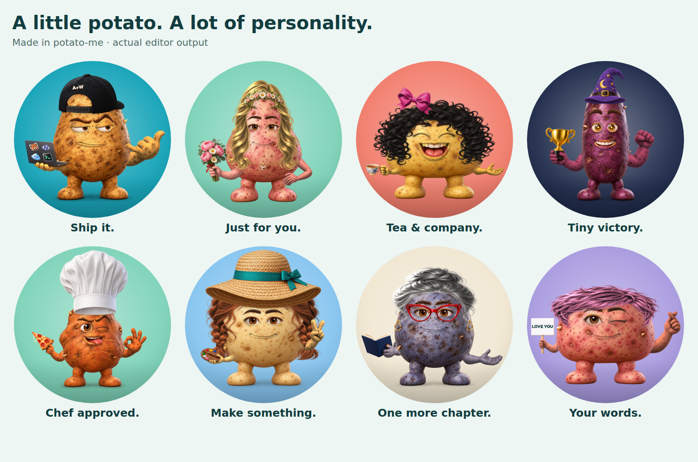

# Public-quality audit — v0.4.0

Historical v0.4.0 record. The current expansion is documented in [EVERYDAY_AUDIT.md](EVERYDAY_AUDIT.md). The gallery below is regenerated from the latest editor and is not a snapshot of v0.4.0.

Reviewed November 1–2, 2026. This update addresses the unnatural attachment of arms, faces and accessories, especially the scarf. The original detailed russet character guided the material detail, expression, cap stitching and hand proportions.



The inventory remains **164 source PNGs**. Fourteen source files were replaced using thirteen accepted generated images: the relaxed arm is shared by the empty holding hand and free-hand layer. No public options were removed. Existing share keys remain supported.

## Repairs

| Finding | Result |
| --- | --- |
| Scarf and other neckwear resembled small floating rings | Rebuilt all six pieces as broad torso wraps. The scarf has knitted folds, a knot and hanging tails; collars reach the silhouette; the lanyard has a smaller badge. Body fitting controls the wrap width and tail height. |
| Flat cap and detached-looking brows | Rebuilt the backward cap with twill, topographic stitching and a separate dark strap; rebuilt smug, angry, worried and flat brows with sculpted volume. |
| Visible arm roots, small laptop support and weak resting pose | Conceal the skin at the shoulder attachment, preserve the overlapping prop, enlarge and inset the laptop support, improve shaka proportions, and replace both resting-hand layers. Hands and held objects remain a single source image so the grip stays intact. |
| Tan facial rims on purple, blue and other skins | Broaden skin matching around eyelids and lips, feather their edges, reduce blush opacity, and replace solid-backed stubble with sparse bristles. Preserve eye interiors, teeth and tongues. |
| Hat crowns exposed the tip of tall bodies; tall hats clipped | Seat each closed crown over the body's actual top and fit its brim to that row. Reframe the whole character when needed instead of shrinking only the hat. |
| Halo sat on the head; flowers disappeared behind hats | Float the halo above the crown and place the flower lower on the side of the head. |
| Monocle and eyepatch centered their chain/strap instead of the eye | Anchor the lens or patch to the eye. Extend only the eyepatch straps to the body edges. |
| Mustaches looked like chin hair or were cut apart by an open mouth | Raise them according to the mouth height and draw them over the mouth. Preserve this order when headphones move above a hat. |
| Wrench paint and musical notes changed with potato skin | Protect those materials separately from the skin mask. |
| Neckwear thumbnails hid the wearable; face thumbnails hid the selected feature | Use relevant crop regions and remove obstructing preview accessories for those controls. |
| Loading feedback lingered after completion; failed loads lacked a clear recovery | Clear the finished overlay immediately and provide a working retry action. |
| Keyboard skip link reset the avatar | Move focus to the controls without changing the state-bearing URL fragment. |
| Text could differ between a direct share link and a download | Serve Fredoka locally and await it before rendering custom lettering. |
| Fitting-tool controls overflowed on mobile | Constrain form controls, give Scope its own row, and fit the action buttons to the available width. |
| Unbounded caches and constant-random-source loops | Bound image/composition caches and sample stickers without replacement. |

The first replacement lanyard was rejected because its oversized badge compressed the strap into a belt. A generated replacement smirk was also rejected because the lip was heavier than the original. The final lanyard was regenerated; the existing thin smirk was retained with improved integration. Prompts and revision notes are in [PUBLIC_AUDIT_PROMPTS.json](PUBLIC_AUDIT_PROMPTS.json).

## What was checked

**11,052 scheduled render cases** cover the matrices below. This is not 11,052 unique avatars: some cases overlap between matrices. It is also not the Cartesian product of every setting. Every source part was checked across all four shapes and all nine skins; interaction matrices add coverage where layers meet.

| Matrix | Cases | Coverage |
| --- | ---: | --- |
| Inventory | 4,644 | 36 bodies, plus each of the other 128 assets on all 36 body/skin combinations |
| Expressions | 1,344 | 14 eyes × 8 brow choices, including none × 12 mouths; shapes and skins distributed |
| Facial hair and neckwear | 2,016 | 6 hair choices × 7 neckwear choices × 4 shapes × 12 mouths |
| Eyewear | 392 | 7 eyewear choices × 4 shapes × 14 eyes |
| Headwear and extras | 480 | 20 hat choices × 6 extras × 4 shapes |
| Held objects and gestures | 660 | 15 held-object choices × 4 shapes × 11 gestures |
| Material colors | 1,056 | 22 recolorable parts × 4 shapes × 12 colors |
| Backgrounds | 168 | 12 patterns × 14 colors |
| Additional details | 292 | All hats with salute; text boundaries; 0–6 stickers; all presets on four shapes; 112 seeded random outfits |

“None” is included where offered. Interaction matrices other than expressions use a representative skin for each shape; the inventory matrix provides the full nine-skin check. Repairs were followed by targeted reruns. Superseded results are identified in the [machine-readable verification record](public-audit-verification.json).

Automated checks rendered every case and round-tripped its share state. Inventory cases also exercised 512 px PNG export and 96 px thumbnail rendering. The final matrices had **zero application errors and zero crop findings** under the documented threshold: more than eight foreground pixels with alpha above 180 outside a radius of 127 on a 256 px render. This detects significant clipping; it is not a claim about every antialiased edge pixel.

Visual inspection was separate from those checks. It covered **311 selected review sheets**, including rerun subsets: attachment points, grips, face edges, worn-item placement, material colors, shadows, proportions and circular cropping. These were AI-assisted visual reviews, not an independent human art review. The verification record identifies the reviewed files by SHA-256. The full sheet images are generated review outputs rather than checked-in assets; the current gallery above is committed and reproducible.

## Editor and repository verification

- **46 Node tests passed.** They cover state validation, old links, asset/index integrity, source-image checksums and format, layer order, fitting geometry and deterministic randomization.
- All **164 source images** are 1024 × 1024 RGBA PNGs; all **164 generated thumbnails** are 256 × 256 RGBA PNGs. Source imports resolve and no credential or dependency directories are tracked.
- Real browser controls passed on desktop and at **390 px**, including light/dark mobile layouts, all five tabs, selected states, keyboard tab navigation and the skip link.
- Cap/sign text, clipboard sharing, exact canvas recreation after reload, crop toggle, reset, randomization and the six-sticker limit passed.
- Both downloaded PNG dimensions were verified. The tested UI outfit exported at **446,766 bytes for 512 px** and **1,869,161 bytes for 1024 px**. Every inventory 512 px export was below 1 MB; that limit is not applied to 1024 px downloads.
- Simulated image-loading failure recovered through the retry button. The editor and fitting page made no third-party requests in the recorded flow.
- Mobile editor buttons met the 44 × 44 px target. The fitting tool accepted an empty holding hand, guarded invalid scale input and stayed within the viewport after its layout repair.
- README, roadmap, changelog, contributor guidance, prompt documentation and earlier audit records were reconciled. The banner, social image, gallery, screenshot and favicon use the actual renderer. Earlier records are explicitly historical.

Browser runs used Chromium **153.0.8010.0** in a managed Linux environment. They do not establish behavior on physical phones or other browser engines.

## Reproduce the review

```bash
npm test
npm install --no-save --package-lock=false playwright
npx playwright install chromium
npm run audit -- /tmp/potato-audit/inventory inventory
npm run audit -- /tmp/potato-audit/expressions expressions
npm run audit -- /tmp/potato-audit/facial-hair facial-hair
npm run audit -- /tmp/potato-audit/eyewear eyewear
npm run audit -- /tmp/potato-audit/headwear headwear
npm run audit -- /tmp/potato-audit/poses poses
npm run audit -- /tmp/potato-audit/colors colors
npm run audit -- /tmp/potato-audit/backgrounds backgrounds
npm run audit -- /tmp/potato-audit/details details
npm run audit:ui -- /tmp/potato-audit/ui
npm run hero
```

The browser audit writes PNG sheets and `report.json`. Inspect the images before accepting the result. A narrower rerun can use a filter, for example `npm run audit -- /tmp/scarf inventory neckwear/scarf` or `npm run audit -- /tmp/scarf-mouths facial-hair neckwear/scarf`. Color-mode filters take a group such as `hat`. The UI script also accepts a deployed URL after its output directory.

## Method and remaining limits

The fitting approach uses body silhouettes, landmark alignment, material masks and contact shading. It is a **2D approximation**, not a 3D model, cloth simulation or physically based renderer. Large hats may naturally cover brows; facial hair and clothing may hide parts behind them. Arbitrary full outfits can still reveal interactions outside the documented matrices. Report these with the exact share link and a screenshot.

Physical iOS/Safari and Android checks, manual VoiceOver/NVDA reviews, and measured Lighthouse scores remain open in the [roadmap](../ROADMAP.md). This audit does not claim WCAG certification or a Lighthouse score.

Research used to structure the work:

- [NIST SP 800-142: Practical Combinatorial Testing](https://csrc.nist.gov/pubs/sp/800/142/final) — interaction coverage and explicit limits; these custom matrices are not a formally generated covering array.
- [Physically Based Rendering: reflection models](https://pbr-book.org/4ed/Reflection_Models) and [visibility/light transport](https://pbr-book.org/4ed/Introduction/Photorealistic_Rendering_and_the_Ray-Tracing_Algorithm) — material, illumination and occlusion principles, adapted here to image compositing.
- [W3C: focus not obscured](https://www.w3.org/WAI/WCAG22/Understanding/focus-not-obscured-minimum.html) and [target size](https://www.w3.org/WAI/WCAG22/Understanding/target-size-minimum.html) — keyboard visibility and touch-control review. The project's 44 px button target exceeds the minimum-size criterion; this is not a complete accessibility audit.
