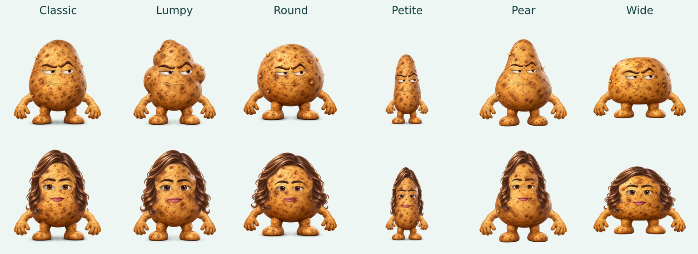

# Shape and variation review — v0.6.1

Historical v0.6.1 record. The [v0.7 wearable review](WEARABLE_REVIEW.md) records the current fitting work and its limits.

Review date: 2026-11-02. This follows the [v0.6.0 review](COHESION_REVIEW.md). That review missed a misleading body label and material/fit defects that became clear in enlarged renders. Its successful render counts were not evidence that every detail looked correct.

## Corrections

| Finding | Change |
| --- | --- |
| The shape called Petite was short and broad; Long was slender but full height | Display the slender shape as **Petite** and the broad shape as **Wide**. Scale the complete Petite character to 82%, including its face, hands and accessories. Preserve historical share keys. |
| A wide held object could make Classic zoom out enough that Petite appeared taller | Cap Petite’s framing scale against Classic wearing the same outfit. Compare actual rendered bounds across both starters, all skins and every held-object choice. |
| Short foreheads flattened entire hairstyles; repeated scanline strips produced horizontal bands | Fit the crown separately from lower locks, give the bun room above the crown, and resample each continuous affine interval once. |
| The raised bun protruded around closed hat crowns | Tuck its crown beneath closed hats while preserving full volume with open headwear; rerun the complete bun interaction matrix and pairwise outfits. |
| Wide exposed background through the backward cap and Viking helmet; its headband covered the crown | Fit the opening to the actual forehead while retaining the hat’s outer dome; reduce band thickness. Raise the flower crown to clear the eyes. |
| Broad protection ellipses left gold skin around open eyes and mouths | Trace mouth interiors, protect actual sclera and visible iris regions, distinguish warm whites from potato skin, and analyze facial masks at 512 px. Preserve teeth, gums, tongues and pupils. |
| Controller/microphone fingers stayed gold; boba tea received skin color | Correct prop-protection boundaries around the full grip and cup. |
| The eye-patch strap crossed the uncovered eye | Route the original leather texture above the eye and attach it at the upper temple. |
| Wide’s lanyard badge hung at foot level | Shorten the drop and uniformly reduce the badge while keeping the wrapping band wide enough. |
| Clips could sit on a bald surface | Add a bob when a hair clip is selected without hair. Choosing no hair removes the clip. Surprise me excludes that incompatible pair. |
| Embroidery could ignore a hat’s vertical fit | Apply the same fitted transform to lettering as to its hat. |



The public labels are Classic, Lumpy, Round, Petite, Pear and Wide. In share URLs and filenames, `long` remains Petite’s key and `petite` remains Wide’s key. These are compatibility keys, not additional body types. Every shape is available with either starting look.

## Review method and evidence

The initial inventory rendered 9,234 cases: each of the 170 non-body images across all 54 body/skin contexts, plus the 54 bodies. Separate visual reviewers inspected the face, limb, style and sticker sheets, then enlarged suspect cases. Eight initially truncated audit PNGs were excluded until replaced or covered by fresh affected-part runs. Audit output now writes complete PNG buffers and renames them into place.

The initial 63 hairstyle interaction sheets covered 3,066 combinations: all hairstyles against hats, extras, jewelry/neckwear and hair colors. That review found the Wide headwear and bun defects. Native-size proofs then exposed resampling bands and mask remnants that 200–256 px overview cells had hidden. Repairs were iterated against the actual source pixels, then the affected matrices were regenerated. That final interaction pass caught the bun protruding around closed hats. A final scoped correction tucks only that crown; the complete bun matrix and pairwise outfits were rerun afterward. The evidence preserves both source digests rather than relabeling earlier runs as later ones.

The [machine-readable evidence](shape-evidence.json) records the final run scopes, source digests, measured results and visual-review manifests. It distinguishes the initial findings from final regression checks. The [shape audit](../scripts/audit-shapes.mjs) measures visible output bounds rather than comparing labels or source-image sizes. The real-control audit checks selection, share/reload behavior, both downloads, mobile layouts, keyboard access, retry and hair-clip compatibility.

The shape regression rendered **756 cases** and measured **342 Petite/Classic comparisons**: both starters, all nine skins and every held-object choice. Petite was **78.7–83.0% of Classic’s visible height** and at most **56.1% of its visible width** in this measured set. The whole-character scale is 82%; the measured ratios also include silhouette and framing differences. These measurements use the resting gesture and no hat, so they do not establish those ratios for every possible outfit.

| Regression scope | Coverage |
| --- | --- |
| Eye and mouth parts | 1,620 cases across all six bodies and nine skins |
| Changed hair, headwear and accessories | 864 cases across all body/skin contexts |
| Eye patch, three held props and two replacement sticker sheets | 324 cases |
| Every individual part on Petite | 1,539 cases: 171 rows across nine skins |
| All hairstyle interactions | 3,066 cases; the 438 bun cases rerun after the closed-hat correction |
| Pairwise outfits | 458 outfits covering 19,102 input-choice pairs, rerun after the final correction |
| Shape proportions | 756 renders and 342 Petite/Classic comparisons |
| Actual browser controls | 16 check groups, including both downloads and mobile themes |
| Node tests | 56 passing tests |

These scopes overlap and are not added into a unique-outfit total. Rendering/crop checks and visual-review manifests are recorded separately in the evidence file.

The complete Cartesian product of all outfits, text values and sticker subsets has not been rendered or visually approved. Pairwise outfits cover pairs of input choices, not every higher-order interaction; the renderer resolves a hairless clip input to a bob. Contact sheets are useful for coverage, while native-size crops are necessary for facial and material boundaries. Physical Safari/iOS and Android testing remains listed in the [roadmap](../ROADMAP.md).

## Reproduce

Follow the optional Playwright/Chromium/Sharp setup in the [README](../README.md#artwork-and-development-tools).

```bash
npm test
npm run audit:cohesion -- /tmp/potato-inventory
npm run audit:shapes -- /tmp/potato-shapes
npm run audit -- /tmp/potato-hair hair
npm run audit -- /tmp/potato-pairs pairwise
npm run audit:ui -- /tmp/potato-ui
npm run hero
```

For a scoped body regression, use `AUDIT_BODIES=long npm run audit:cohesion -- /tmp/potato-petite`. Reports include the selected body keys. Review the generated PNGs; a clean loading/crop report alone does not establish visual quality.
