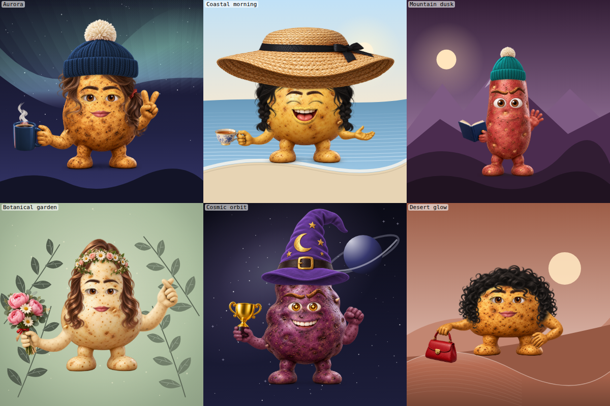

# Wearable fitting and editor review — v0.7.0

Reviewed 2026-11-02. This release addresses headwear that floated above the head, hair that did not follow the temples, oversized small accessories, and an editor whose broad sections hid related controls. Earlier audit records describe earlier versions; passing render counts did not establish that their artwork looked natural.

## What changed

| Finding | Correction |
| --- | --- |
| A hat's outer image width was treated as its wearing opening | Measure the opening separately for each wearable. Fit its width and seating depth to the body and the selected hairstyle. Keep brim, crown and pom-pom proportions independent where needed. |
| Hair left temple gaps on Petite or looked bulky on Wide | Fit the face opening, crown volume and free length separately. Use continuous inverse sampling so strands do not acquire seams at fitting joins. |
| Shadows stopped at the bare body even when hair was underneath | Clip contact shadows to the actual accumulated receiving surface, including hair and earlier accessories. |
| Empty undersides in source art could not be made to sit naturally | Replace the chef hat, crown and Viking helmet with front-facing artwork. Source provenance and prompt summaries are in [IMAGE_PROMPTS.md](IMAGE_PROMPTS.md). |
| The backward-cap window exposed gaps or unrelated skin patches | Fill only missing receiver pixels, sampling adjacent scalp or hair. Preserve existing pixels inside the opening. |
| A broad headband exposed hanging rear ends or darkened sprouts | Keep the front band, trim its rear ends and fit to a smoothed head contour. |
| Small jewelry and clips retained the same size across bodies | Scale them with body width and attach clips to the fitted hair surface. |
| Controls were crowded into Style and Gear | Add dedicated Hair, Headwear, Accessories, Props, Gestures and Stickers sections; retain Body, Face and Background. All nine tabs support keyboard navigation and mobile touch targets. |
| Background choices lacked variety | Add six illustrated scenes and twelve colors, for 18 scenes/patterns and 26 colors. Scene colors derive from the selected palette. |



## Evidence and scope

The [machine-readable evidence](wearable-evidence.json) separates broad structural runs, later affected-part reruns, and visual inspection. Counts overlap and must not be added into a unique-outfit total. The broad runs preceded the final cap/headband contact and hat-color corrections; the affected scopes were rerun after those corrections.

| Automated scope | Cases / checks |
| --- | --- |
| Every individual source part across six bodies and nine skins | 9,234 renders, 171 inventory rows |
| All hairstyle interactions with headwear, extras, jewelry/neckwear and hair color | 3,066 renders |
| Pairwise input coverage | 608 outfits covering all 22,570 required input pairs |
| Every background color and pattern | 468 renders; all 26 botanical colors rerun after moving foliage into the crop |
| Shape proportions | 756 renders and 342 Petite/Classic comparisons |
| Six changed hats after source/proportion corrections | 324 body/skin cases and 252 hairstyle cases |
| Final backward-cap and headband contact corrections | 108 body/skin cases, PNG exports and thumbnail checks; 84 hairstyle cases |
| Final hat color masks | 1,224 cases: 17 hats × 12 colors × six bodies |
| Browser controls | 17 check groups, including 512/1024 PNG downloads, share/reload, keyboard access and 390 px mobile themes |
| Node regression tests | 57 passed |

The structural runs reported no loading, share-roundtrip or circular-crop findings in their recorded scopes. Those checks do not judge anatomy, texture, contact or artistic quality.

Visual inspection included all 42 native 1024 px bare-head proofs (seven hairstyles on six bodies); a 132-case headwear overview with enlarged suspect cases; a 72-case follow-up covering six affected hats with and without a bob; and every one of the final 24 native cap/headband contact proofs. The final contact review found the previously reported gaps, patch seams and hanging headband ends resolved in that set. Root review also inspected the final cap/headband sheets for all seven hairstyles, accessory overview sheets, the new scenes and the actual editor. Exact reviewed-image hashes and bounded findings are recorded in the evidence.

## Remaining limits

This remains a modular 2D image compositor. Source parts have baked texture and lighting; matching the hue does not make their pore detail or material roughness identical. Small reflected texture details remain inside some cap windows, including a bright diagonal scalp ridge on Round. These were recorded rather than described as flawless.

No full Cartesian product of every outfit, text value and sticker subset has been visually approved. Pairwise coverage covers input pairs, not every higher-order combination. Native proofs focus on the defects and body extremes above; contact-sheet cells are too small to establish pixel-level quality. Physical Safari/iOS and Android testing remains outstanding in the [roadmap](../ROADMAP.md).

## Reproduce

Install the optional Playwright/Chromium/Sharp development tools described in the [README](../README.md#artwork-and-development-tools), then run:

```bash
npm test
npm run audit:cohesion -- /tmp/potato-inventory
npm run audit -- /tmp/potato-hair hair
npm run audit -- /tmp/potato-pairs pairwise
npm run audit -- /tmp/potato-backgrounds backgrounds
npm run audit:shapes -- /tmp/potato-shapes
npm run audit -- /tmp/potato-contact inventory hat/backwardCap hat/headband
npm run audit -- /tmp/potato-contact-hair hair hat/backwardCap hat/headband
npm run audit -- /tmp/potato-hat-colors colors hat
npm run audit:ui -- /tmp/potato-ui
npm run hero
npm run shot -- docs/scenes.png docs/scenes-spec.json --cell 400 --cols 3
```

Review generated images at native size as well as in sheets. A successful render is evidence of a working code path, not visual approval.
