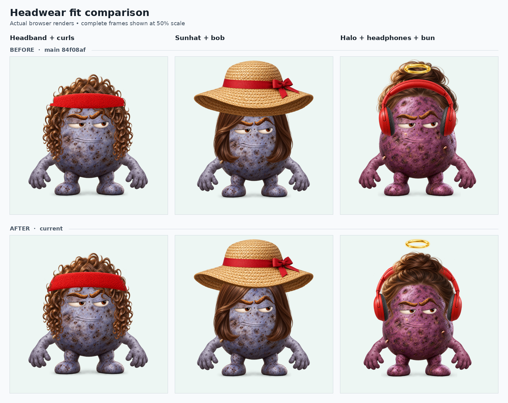

# Headgear overlap review — v0.7.1

Reviewed 2026-11-02. This follows the v0.7 wearable-fitting work and addresses the visible rear edges that made fitted headgear look laid over the character. All 224 source images are reused; no artwork or asset inventory was regenerated.

## What changed

| Finding | Correction |
| --- | --- |
| Dark hat interiors remained visible across the hair/head | Split measured rear surfaces from the original PNG and draw them behind the wearer, while the original front brim stays in front. |
| A general lower-edge mask would remove exterior details | Use part-specific source paths. Preserve complete Santa, beanie and chef cuffs, decorative ribbons and the barrette leaf. |
| Headphones sat inside thick hair or across a raised bun | Keep the cups rigid, fit their lateral position to the worn head, flex the band, and let hair overlap its rear section. |
| A halo intersected the bun or headphone band | Place its bottom above the measured hair and fitted band, then frame the whole character. |
| Glasses looked like a frame pasted on the face | Sample the existing hinge material for temple arms, keeping the front frame/lenses unchanged and hiding the arms under hair. |
| Earbud tips floated beside the body | Seat their inward-facing nozzles slightly inside the actual left/right contour, with the insertion region behind the body. |
| The headband had a hard cut/spike at the sides | Correct its source front curve and smooth the lateral contact around the wearer. |

Both halves of a split wearable use the same fit, including crown warps and thumbnail source scaling. Full-size artwork is still drawn in world space before camera fitting, so tall tips are not clipped to an intermediate 1024 px plane. The preview, thumbnail and PNG export share this path.

## Visual comparison



The top row uses main commit `84f08afcea90e39124a02d9fca6a3eb471e9dfd1`; the bottom row uses the corrected renderer. Complete 1024 px frames are shown at 50% scale. The examples show the headband's lateral contact, the sunhat's rear underside behind hair, and a halo above both a bun and headphones.

## Verification completed locally

Recorded in Chromium 153 on 2026-11-02. [wrap-evidence.json](wrap-evidence.json) retains source fingerprints, case counts, proof hashes, inspection scope and browser-check results.

| Check | Scope | Result |
| --- | --- | --- |
| Node tests | 68 tests, including source-image integrity, state compatibility and the new fit/wrap regressions | All passed |
| Headwear thumbnail matrix | 22 headwear options × 8 hair states × 6 body shapes = 1,056 renders, using actual 256 px thumbnail PNG inputs | No script, share-round-trip or crop findings; all 30 sheets visually inspected |
| Skin/body stress cases | 6 shapes × 9 skins × 5 outfits = 270 renders from full source PNGs, at 256 px | No automated findings; all 8 sheets visually inspected |
| Accessories and stacking | 30 glasses cases, 48 headphone/hair/body cases, and 36 headphones-over-closed-hat cases = 114 full-source renders at 256 px | No automated findings; all 4 sheets visually inspected |
| Native contact proofs | 24 selected 1024 px images covering affected brims, headbands, headphone cups, halo, glasses, earbuds and preserved decoration | Individually inspected; the flower-crown finding was corrected and rechecked |
| Flower-crown follow-up | All 48 hair/body combinations at thumbnail resolution plus the affected native proof | Both detached rear branch tips now hide behind the wearer; front flowers remain whole |
| Editor/browser flow | 18 check groups covering all nine sections, keyboard controls, share/reload, text, stickers, retry behavior, thumbnails, downloads and mobile layouts | All passed; no script errors or third-party requests |
| PNG downloads | Real 512 × 512 and 1024 × 1024 downloads | Valid PNGs; 272,491 bytes and 988,923 bytes respectively; the tested 512 px export is below 1 MB |

The skin stress outfits were headband/curls, halo/bun/headphones, Santa/waves, cat-eye glasses/bob, and bare-head earbuds. Skin and accessory sheets were inspected at 256 px per cell; that inspection is distinct from the 24 individually viewed native images. Six additional native headband proofs cover all body shapes, including editable initials. Desktop and 390 px mobile layouts were checked in light and dark themes. Mobile controls had no horizontal overflow and met the 44 × 44 px button checks; concurrent body/skin thumbnails matched fresh sequential renders within the audit's two-channel-value tolerance.

The broad runs used source digest `d589d43aa92db02998c750a6b5a20d526871266540749002b7b3c946c9a7ec87`. Native inspection then found that the flower-crown rear mask stopped before its inward branch tips. The final change only expands that one mask; the 48 affected thumbnail cases and one native proof were rerun at final digest `4e615207b9c4736ff5715965ea14b0c2594660caa5d8136ce1b121048e085bcf`. The earlier flower-crown cells are superseded by that follow-up. The other 1,008 headwear matrix cells and the skin/accessory scopes are unaffected. These counts overlap and are not a count of unique full outfits.

An independent code review found no blocking issue in source-resolution handling, split-image caching, front/rear registration, receiving-layer order, combined headphone fitting, temple rendering, halo clearance or existing share-state compatibility. All 224 original PNGs remain unchanged. The banner, link-preview card, gallery and favicon were regenerated from the actual renderer.

## Publication and production verification

Published and verified on **2026-11-02** at [potato-me.vercel.app](https://potato-me.vercel.app/). [PR #11](https://github.com/WaylandP/potato-me/pull/11) merged the reviewed application tree as commit [`48360e6db51d1d16c0e1c24c0358d5788408206f`](https://github.com/WaylandP/potato-me/commit/48360e6db51d1d16c0e1c24c0358d5788408206f). The [pull-request CI run](https://github.com/WaylandP/potato-me/actions/runs/41543384428) and [main-push CI run](https://github.com/WaylandP/potato-me/actions/runs/41543762201) both passed. Vercel deployment `dpl_CQSJz1SnATwWHjAnDFfLgKxcpghB` reached `READY` for that exact commit and held the production alias. This records the application deployment verified on that date; later documentation-only commits do not change its renderer.

| Production check | Observed result |
| --- | --- |
| Public page and source identity | Homepage returned HTTP 200. Ten served runtime/manifest files matched their reviewed SHA-256 hashes exactly, with TLS verification enabled. |
| Native PNG exports | Downloaded and individually inspected four 1024 × 1024 PNGs from the live editor: headband/curls, halo/headphones/bun, sunhat/bob, and round body/flower crown/waves. The repaired contact and overlap boundaries were present in the actual exports. |
| Share URL reload | Reloading the public hash URL retained the avatar. Real 512 × 512 downloads before and after reload were byte-for-byte identical: 374,282 bytes, SHA-256 `052e41aa8f915aa31fdcdbe7a816cc8f17bff76068cc16afb47fa16cc3b86520`. |
| Copy link control | The live control displayed its success toast. The managed browser's clipboard read returned no data, so clipboard contents were not independently verified on production; exact clipboard/state checks remain part of the local UI audit. |
| Application console | No application-origin warning or error was observed during these production checks. The browser extension logged unrelated metadata-delivery errors. |

Production interaction was checked in the managed Chrome browser at its desktop viewport. The local 390 px/mobile, light/dark and broad matrix results above were not rerun on production. Preview build/status metadata was verified; protected-preview page access was unavailable, so the live interaction checks used the public production alias. [wrap-evidence.json](wrap-evidence.json) records the deployment identifiers, served-file hashes and actual download hashes separately from the earlier local audit.

## Remaining limits

This is a modular 2D compositor with baked lighting. Automated renders establish loading, state round trips and crop behavior; they do not establish aesthetic approval. Visual inspection is recorded separately, with native contact proofs for the affected boundaries. Physical iOS/Safari and Android testing remains outside this recorded Chromium review.

## Reproduce

Install the optional Playwright/Chromium/Sharp development tools described in the README, then run:

```bash
npm test
npm run audit:wrap -- /tmp/potato-wrap-native focused
npm run audit:wrap -- /tmp/potato-wrap-headwear matrix
npm run audit:wrap -- /tmp/potato-wrap-skins skins
npm run audit:wrap -- /tmp/potato-wrap-accessories accessories
npm run audit:ui -- /tmp/potato-wrap-ui
```

The wrap audit writes case states, share hashes, crop checks, labeled review sheets and a digest of the renderer/manifest used. `focused` also writes native 1024 px images. `matrix` uses the actual thumbnail PNG inputs; the other modes use full source PNGs. `CHROME_EXECUTABLE` may select an existing Chromium binary for that development tool. To rerun only a changed part, use a label filter, for example `AUDIT_MATCH=flowerCrown npm run audit:wrap -- /tmp/potato-wrap-flower matrix`. Inspect the images: a successful command does not judge their artistic quality.
